<div align="center">

<!--  -->

# Ionix

**A modern, gaming-ready Arch Linux distribution powered by Hyprland**

*Beautiful by default. Fast by design. Built for efficiency and customizability.*

</div>

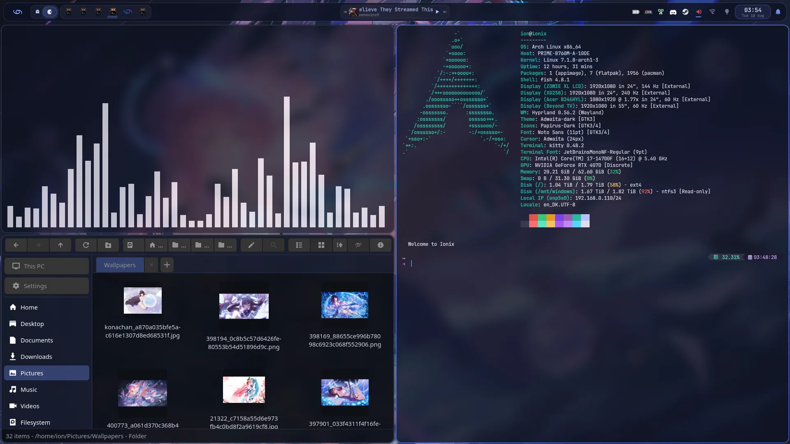

---

## What Ionix is

Ionix is an Arch Linux distribution with the desktop already built. It ships as a bootable live
ISO with a graphical installer, and what you get after installing is what you see above - a
[Hyprland](https://hyprland.org/) Wayland session with a purpose-built shell, a themed terminal,
a configured editor, gaming tuned in, and no post-install checklist to work through.

The distinctive part is the shell. Most Hyprland setups are a pile of dotfiles glued to a
general-purpose bar. Ionix ships **ionix-quickshell**, a desktop shell written specifically for
it: a start menu, a taskbar, an Alt-Tab switcher with live window previews, and settings you
change by clicking them. It is a tiling Wayland compositor that behaves like a desktop you
already know how to use.

Underneath, nothing is hidden or wrapped. It is Arch: `pacman`, the AUR, rolling releases, the
wiki. If you already know Arch, everything you know still applies.

**Ionix is for you if** you want a fast, current, Wayland desktop without spending a weekend
assembling one; you game on Linux and would rather not hand-tune kernel parameters; or you want
Arch as a daily driver with the setup already done.

**Ionix is not for you if** building your own desktop is the part you enjoy. That is a completely
reasonable thing to want - and Ionix is the opposite of it. Install plain Arch instead.

> **Project status.** Ionix is a small, actively developed project, and there is no tagged
> release yet - you build the ISO yourself (see [BUILDING.md](BUILDING.md)) or pull the artifact
> from a CI run. It installs and boots on real hardware and in QEMU, and it is used daily by
> myself. Expect rough edges, and expect things to move. Changes are based on things I want to see
> in my own desktop, which will be the system's baseline.

---

## Highlights

| | |
|---|---|
| **Familiar, not foreign** | Start menu, taskbar, and an Alt-Tab switcher with live previews - on a tiling compositor |
| **Themes that switch everything** | One command restyles the shell, Hyprland, kitty and the file manager together |
| **Colours from your wallpaper** | The `ionix-adaptive` theme derives its whole palette from whatever image is on screen |
| **Built for gaming** | SteamOS-style kernel tuning, with Steam, Lutris, Proton and MangoHud preloaded |
| **Two desktops, one install** | Hyprland or a full GNOME session, chosen at the boot menu |
| **The desktop updates itself** | The shell and Ionix's own configs are normal AUR packages, so `yay -Syu` advances them without a new ISO |
| **Rolling Arch underneath** | Full `pacman` and AUR access; nothing wrapped, nothing hidden |

---

## The desktop

### The bar

The bar floats, blurs what is behind it, and rounds its corners. Left to right it carries the
launcher button, Task View, workspaces, a window taskbar, now-playing media, the system tray, and
indicators for audio, network, bluetooth, Philips Hue and battery, then the clock and the
notification bell. There is one bar per monitor.

It also turns. `bar.position` takes `top`, `bottom`, `left` or `right`; dock it to a side edge
and every module restacks vertically, the clock switches to a stacked format, and popouts open
sideways instead of downward.

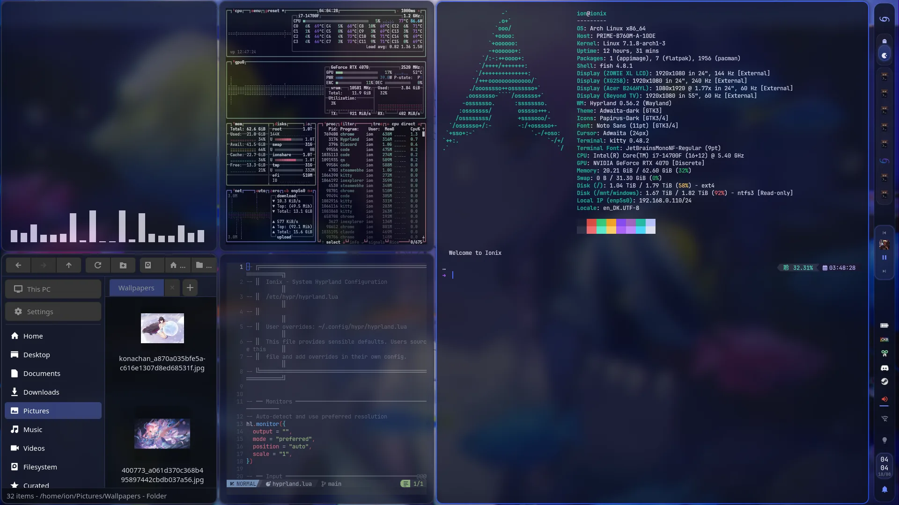

### Start menu

Tap `Super` and you get a start menu: pinned tiles, the apps you actually use, what is currently
running, and a footer with your identity, a theme picker and power controls.

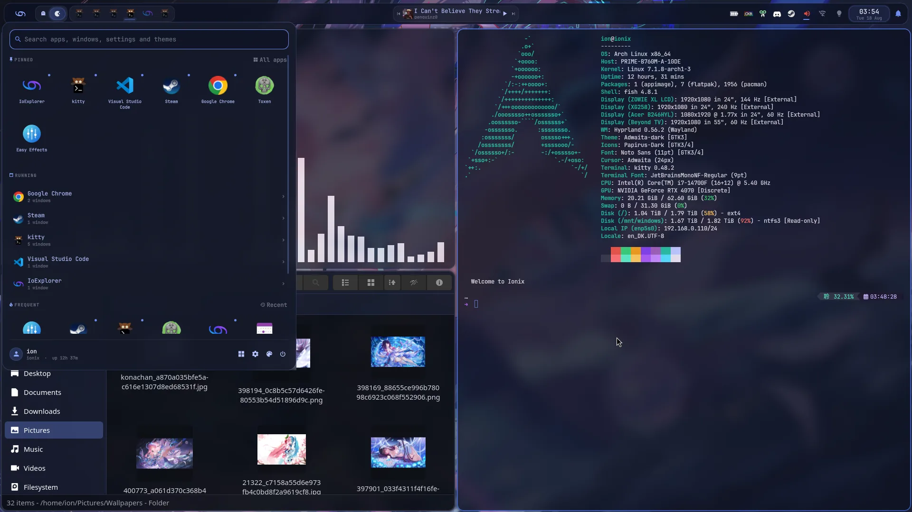

The search box covers four different things at once. Typing `net` here returns shell actions
(Wi-Fi, notifications), matching applications, **and your open windows** - and picking a window
raises it rather than starting a second copy of the app. Theme names match too, so switching
theme is something you can type.

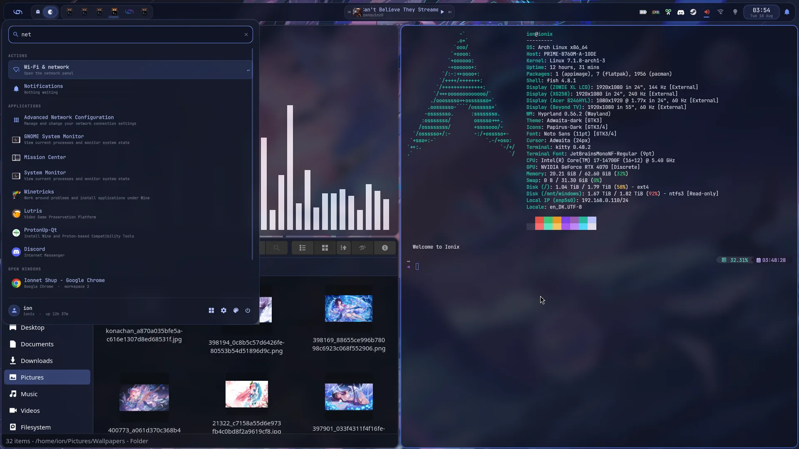

### Alt-Tab

`Alt+Tab` opens a switcher overlay with a live preview of every window, in most-recently-used
order. Hold `Alt` to browse, `Shift+Alt+Tab` walks backwards, and it commits when you let go of
`Alt` - so a quick tap flips between the two windows you were just using. It can span every
workspace or stay on the current one.

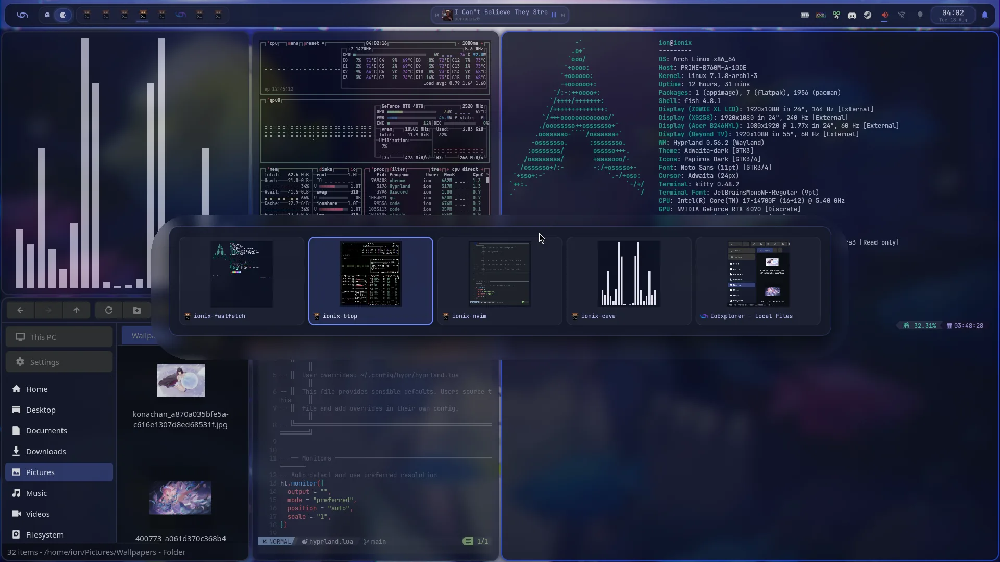

### Project workspaces

Save a workspace as a named project - the apps on it, which folder each terminal was in, and
where every window sat - and open it again later with one click. It opens on the next free
workspace, so it never disturbs what you already have open, and the workspace carries the
project's name in the bar and on the Alt-Tab cards. Projects live in the start menu
(`Ctrl+Super+P`), in its search, and on the command line:

```bash
ionix-project save "Ionix ISO"     # this workspace, as a project
ionix-project load "Ionix ISO"     # open it again on a free workspace
ionix-project list
```

Each project is a small JSON file in `~/.config/ionix/projects/` that is fine to edit by hand -
add an `"exec"` line to a window to change how its app is started.

### Panels, not applets

Clicking an indicator opens a panel drawn by the shell itself rather than launching a separate
application. The audio panel is a full mixer with a slider for every application that is making
sound. The network panel lists Wi-Fi networks and takes the password inline. There are panels
for bluetooth devices, a calendar, the media player, a
power menu with power-profile switching, and Philips Hue lights.

<table>
<tr>
<td width="50%">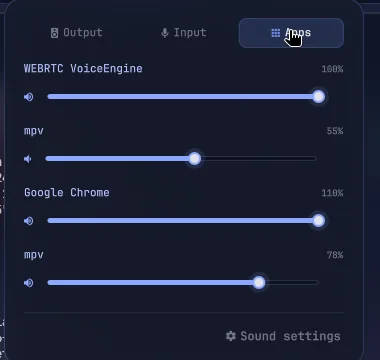</td>
<td width="50%">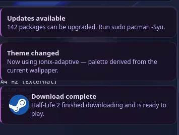</td>
</tr>
</table>

The shell is also the notification server, so notifications are styled like everything else
rather than borrowed from another daemon.

### Settings you can click

The gear in the start menu opens a settings page inside the shell. Bar position, which
indicators appear, notification popups, the on-screen display and the Alt-Tab switcher are all
switches here - no file editing. Anything you have pinned by hand in `config.json` shows up
greyed out and labelled, so the two never fight.

<div align="center">
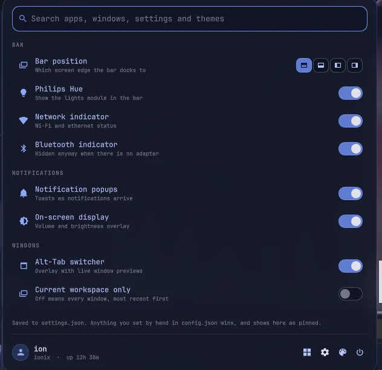
</div>

---

## Themes

`ionixtheme <name>` restyles the shell, Hyprland, kitty and the file manager in one go, and
reloads each of them in place - open terminals restyle without being restarted. The same
switcher lives in the start menu footer with live colour previews, and you can just type a theme
name into search.

It themes the terminal itself too: fish's syntax colours, the oh-my-posh prompt, `fzf`, `btop`,
`bat`, and the 16 colours of the plain text consoles on Ctrl+Alt+F2 and up. New shells pick a
switch up straight away.

Three of the four shipped themes, on the same desktop:

| `ionix` | `ionix-pro` | `winix` |
|---|---|---|
| 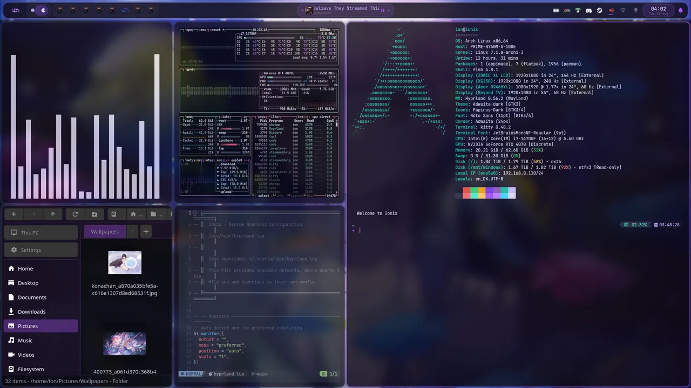 | 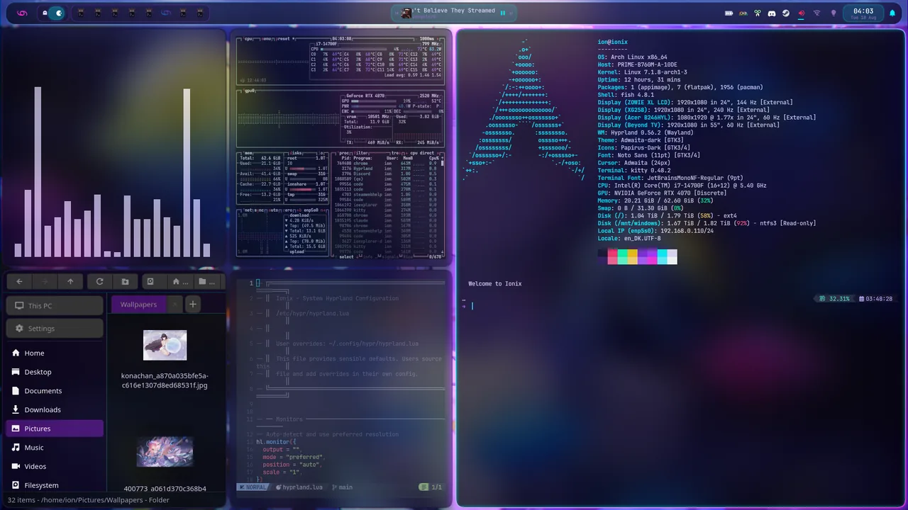 | 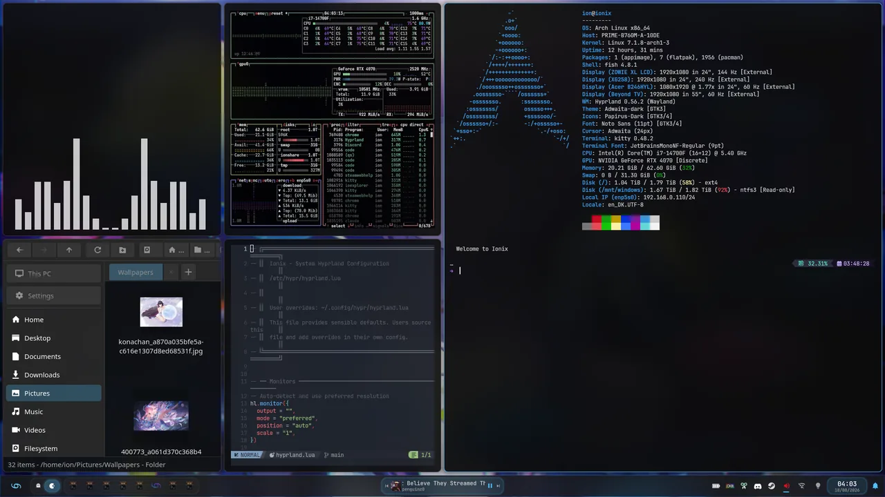 |
| The default. Deep purple, floating bar. | Near-black with neon violet and cyan. | Windows 11 Fluent: bottom bar, edge to edge. |

### Colours from your wallpaper

The fourth theme, `ionix-adaptive`, does not state its colours - it derives them. Set a wallpaper
and the entire palette follows the image, across the shell, Hyprland's borders, the terminal and
the file manager. Same desktop, same windows, two different wallpapers:

| | |
|---|---|
| 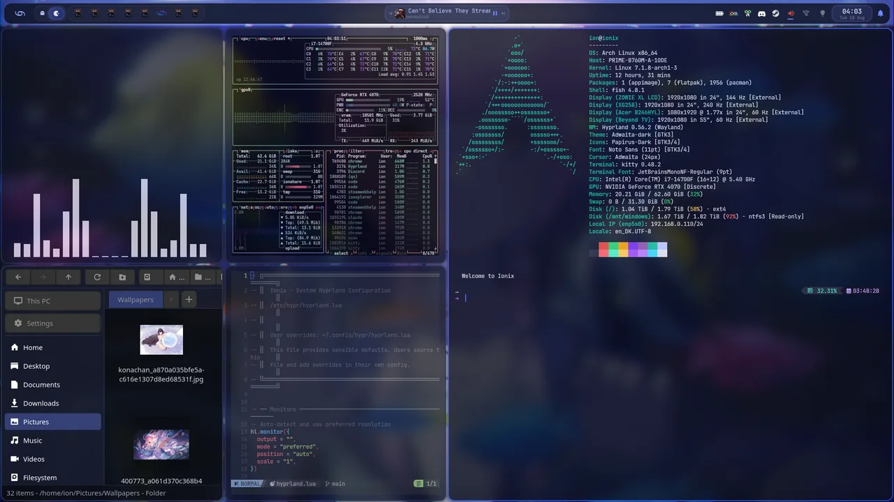 | 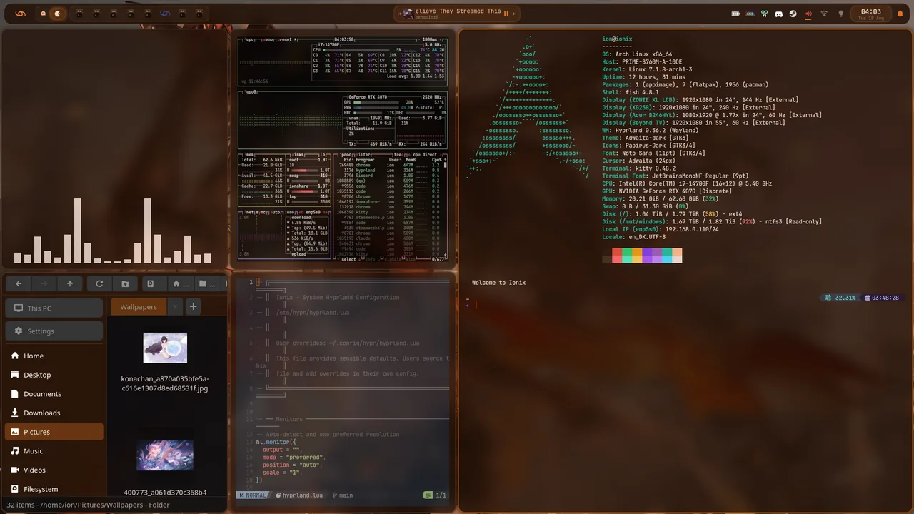 |

The lightness of every colour slot is fixed and only hue and chroma follow the image, so text
contrast stays where it was designed to be no matter what you point it at. It re-derives itself
whenever the wallpaper changes and at login, and falls back to the theme's static colours if
anything goes wrong.

Wallpapers themselves are handled by `awww`: `Ctrl+Super+W` opens a picker, and `Super+Alt+W`
deals a different random wallpaper to each monitor.

---

## Keyboard shortcuts

All of these live in `/etc/hypr/hyprland.lua`. Override any of them in
`~/.config/hypr/hyprland.lua`. `Super` is the modifier throughout.

### Essentials

| Shortcut | Action |
|---|---|
| Tap `Super` | Toggle the start menu |
| `Super+R` / `Alt+Space` | Spotlight launcher |
| `Super+T` | Terminal (kitty) |
| `Super+E` | File manager (IoExplorer) |
| `Super+W` | Google Chrome |
| `Super+Q` | Close window |
| `Alt+Tab` | Window switcher (hold `Alt` to browse) |
| `Super+1`…`0` | Go to workspace 1–10 |
| `Super+V` | Clipboard history (CopyQ) |
| `Super+L` | Lock the screen |

### Windows

| Shortcut | Action |
|---|---|
| `Super+Space` | Toggle floating |
| `Super+F` / `Super+D` | Fullscreen / maximise |
| `Super+Alt+F` | Fake fullscreen (window thinks it is fullscreen) |
| `Super+P` | Pin above everything |
| `Super+J` | Cycle tiling layout (dwindle ↔ master) |
| `Super+←↑→↓` | Move focus (also `Super+[` and `Super+]`) |
| `Super+Shift+←↑→↓` | Move the window |
| `Super+Alt+←↑→↓` | Resize (add `Shift` for 2 px steps) |
| `Super+Shift+U` | Jump to the urgent window, or the last one |
| `Super+G` / `Super+Shift+G` | Group windows / lock the group |
| `Super+Ctrl+Tab` | Next window within a group |

### Workspaces

| Shortcut | Action |
|---|---|
| `Ctrl+Super+←→` | Previous / next workspace |
| `Super+PgUp` / `PgDn` | Next / previous workspace (±5 with `Ctrl`) |
| `Ctrl+Super+Alt+←→` | Workspace on the other monitor |
| `Super+Alt+1`…`0` | Send window to a workspace, stay put |
| `Ctrl+Super+Shift+1`…`0` | Send window to a workspace and follow it |
| `Super+S` / `Super+Shift+S` | Toggle the scratchpad / throw a window into it |
| `Super+numpad 1`…`9` | Snap this workspace's windows into a grid, laid out like the numpad |
| `Super+numpad 0` | Put everything back under the tiler |
| `Ctrl+Super+P` | Projects: open, rename or delete a saved project workspace |
| `Ctrl+Super+Shift+P` | Save this workspace as a project |

### Screenshots

| Shortcut | Action |
|---|---|
| `Print` | Select a region → clipboard |
| `Ctrl+Print` | This monitor → clipboard |
| `Super+Print` | Select a region → `~/Pictures/` |
| `Ctrl+Super+Print` | Every monitor → clipboard |

### Desktop and shell

| Shortcut | Action |
|---|---|
| `Super+N` / `Super+Shift+N` | Notification centre / do not disturb |
| `Ctrl+Super+W` | Wallpaper picker |
| `Super+Alt+W` | Shuffle wallpapers across all monitors |
| `Ctrl+Super+scroll` | Zoom the screen around the cursor (`Ctrl+Super+Alt+0` resets) |
| `Super+.` | Emoji and symbol picker |
| `Alt+←` / `Alt+→` | Back / forward in the focused window |
| `Super+B` | btop in a terminal |
| `Ctrl+Alt+T` | Tabby terminal |
| `Super+Shift+B` | Restart the shell |
| `Ctrl+Super+Shift+B` | Launch Waybar (escape hatch if the shell misbehaves) |
| `Ctrl+Super+R` | Reload the Hyprland config |

### Mouse

| Gesture | Action |
|---|---|
| `Super+drag` / `Super+right-drag` | Move / resize a window |
| `Super+scroll` | Change workspace |
| `Super+Shift+scroll` | Cycle within a window group |

Media and brightness keys work as expected. Volume and brightness route through the shell so the
on-screen display shows the exact new value, with `wpctl` and `brightnessctl` as fallbacks if the
shell is not running.

---

## Under the hood

The shell is [fish](https://fishshell.com/) with an [oh-my-posh](https://ohmyposh.dev/) prompt,
`zoxide` for directory jumping, and `lsd`, `bat`, `ripgrep`, `fd` and `fzf` in place of the
classic tools. Neovim is preinstalled and clones the [NvChad](https://nvchad.com/) starter
configuration the first time you log in. `kitty` is the default terminal; `foot` runs as a server
for near-instant launches, and `Tabby` is there if you want tabs and panes.

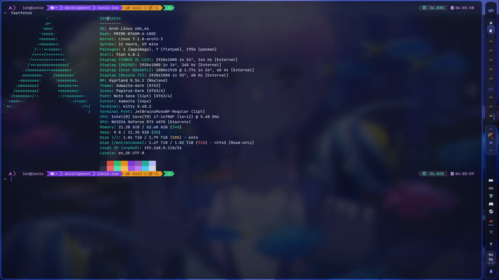

---

## What's installed

**Desktop:** Hyprland, ionix-quickshell, IoExplorer and Nemo, hyprlock, CopyQ, Blueman,
pavucontrol, nwg-displays, hyprshot, hyprpicker, wf-recorder, Papirus icons.

**Terminals and shell:** kitty, foot, Tabby, fish, oh-my-posh, btop, htop, fastfetch, bat,
ripgrep, fd, fzf, jq, zoxide, lsd.

**Development:** Neovim with NvChad, git, Docker, Python, Node.js, and `yay` for the AUR.

**Internet:** Google Chrome, NetworkManager with its GUI, and `openconnect-sso` for VPNs with
single sign-on.

**Gaming:** Steam, Lutris, Wine Staging with winetricks, ProtonUp-Qt, GameMode, MangoHud,
Gamescope, OBS Studio, AntiMicroX, and `ananicy-cpp` for automatic process priorities.

**Graphics:** Mesa with Vulkan for AMD and Intel, `nvidia-open` for NVIDIA, plus the 32-bit
libraries games need. Audio is PipeWire with PulseAudio, ALSA and JACK compatibility.

**A second desktop:** a full GNOME session is installed alongside Hyprland. Pick **Ionix - GNOME**
at the boot menu and GDM starts instead, with Ionix's GNOME defaults already applied.

The authoritative lists are [`profiles/common/packages.x86_64`](profiles/common/packages.x86_64)
and [`profiles/desktop/packages.x86_64`](profiles/desktop/packages.x86_64).

### Gaming tuning

Ionix ships SteamOS-inspired kernel settings out of the box
([`99-ionix-gaming.conf`](system/desktop/etc/sysctl.d/99-ionix-gaming.conf)):

- `vm.max_map_count = 2147483642` - required by many Proton and Wine titles
- Split-lock mitigation disabled - older games trip it and get serialised by the kernel
- Reduced memory compaction stalls and a shorter page-lock unfairness window
- NMI watchdog off
- Larger UDP buffers for online play
- `ananicy-cpp` managing CPU priorities for games and background tasks

---

## Installing

1. **Get an ISO.** There is no published release yet, so build it - see
   [BUILDING.md](BUILDING.md) - or take the artifact from a CI run.
2. **Write it to a USB stick** with `./flash-usb.sh`. It picks the newest ISO in `out/`, refuses
   to offer your system disk, and makes you type the target device path back before it writes.
3. **Boot it.** The live session logs in by itself and the installer opens about two seconds
   later. If you close it, run `ionix-install` or use the desktop entry.
4. **Work through Calamares** - language, timezone, keyboard, partitioning, and your user account.

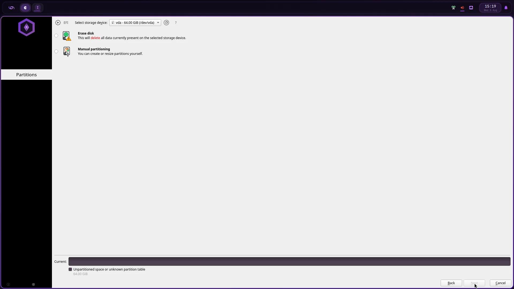

5. **Reboot** and remove the installation media.

### What the installer sets up for you

Installation does more than copy files. It makes fish your login shell, enables autologin on
tty1, turns on NetworkManager, bluetooth, power-profiles-daemon and ananicy-cpp, removes the
live-session artefacts, installs a proper kernel and initramfs in place of the archiso one,
drops the local `[ionix]` repository and initialises the pacman keyring so the system can update
itself immediately.

It also handles graphics: with an NVIDIA card it enables DRM modesetting
(`nvidia_drm modeset=1 fbdev=1`) and puts the NVIDIA modules in the initramfs for early loading.
With no NVIDIA card it removes the NVIDIA packages entirely to save the disk space.

For Secure Boot, `shim-signed`, `sbctl` and `mokutil` are installed so you can enrol your own
keys after installation.

### First login

The first Hyprland session clones the NvChad configuration for Neovim, creates the standard XDG
user directories, and applies the dark GTK and icon themes. It runs once and then gets out of
the way.

---

## Ionix Server

The same Ionix, minus the desktop: a separate ISO for home servers and dedicated boxes, built with
`./docker-build.sh --variant server`. You get the fish shell, prompt, themes and tools you already
know, and nothing graphical.

- **A CLI installer**: `ionix-server-install` asks a handful of questions at the console or over
  SSH, or reads them all from an answer file and installs with no one at the keyboard.
- **SSH from the first boot**: put your public keys in the answer file and you can log into the
  *live medium* before anything is installed. The installed system takes keys only, by default.
- **A firewall that's on**: ufw denies everything incoming except SSH and the ports you list.
- **Undo for updates**: btrfs with snapper takes a snapshot before and after every `pacman`
  transaction, and every snapshot is bootable from the GRUB menu. A bad update is one reboot
  from gone.
- **A console that looks like your terminal**: plug a screen in and the text console renders
  JetBrainsMono Nerd Font in your theme's colours, prompt icons and all, courtesy of kmscon. If it
  can't start, you get a plain console instead.
- **LTS kernel, Docker, systemd-networkd**, serial console support for IPMI, and GRUB installed
  for both BIOS and UEFI, so the disk boots wherever you move it.

```bash
ionix-server-install example > install.conf    # on the live medium: a commented answer file
ionix-server-install disks                     # what it can install to
ionix-server-install                           # install, asking for whatever's missing
```

Unattended installs are covered in [BUILDING.md](BUILDING.md#unattended-server-installs).

---

## Making it yours

**The shell.** Four levels, in increasing order of commitment: the settings page for the common
switches; `~/.config/quickshell/ionix/config.json` for anything else, which is deep-merged over
the defaults and applied live without a restart; a `user.qml` for your own QML; and
`ionix-shell-fork mine` to copy the whole shell somewhere you can rewrite it. Every available key
is documented in `/etc/xdg/quickshell/ionix/defaults.json`.

**Hyprland.** Your config lives at `~/.config/hypr/hyprland.lua` and loads the system defaults
first, so you only write the differences. The keyboard layout follows the one you picked in the
installer; `sudo localectl set-x11-keymap de` changes it for the whole system from the next login.

```lua
-- Use a different keyboard layout in Hyprland only
hl.config({ input = { kb_layout = "us" } })

-- Add your own keybinding
hl.bind(mainMod .. " + code:60", hl.dsp.exec_cmd("yourapp"))

-- Pin a monitor layout
hl.monitor({ output = "DP-1", mode = "2560x1440@144", position = "0x0", scale = 1 })
```

**Sounds.** Ionix ships silent, but any desktop event can make a noise: drop an audio file named
after the event into `~/.config/hypr/sounds/`, such as `openwindow.wav` or `shutdown.mp3`. It
works from the next time that event happens, and sounds overlap rather than wait for each other.
`ionix-sounds` lists every event and what is set.

| Event | Plays when |
|---|---|
| `boot`, `login` | The first session after the machine starts; every session after that (`login` also stands in for a missing `boot`) |
| `logout`, `shutdown`, `reboot` | The session ends; the machine powers off; it reboots (`shutdown` stands in for a missing `reboot`) |
| `suspend`, `resume` | The machine goes to sleep; it wakes up |
| `lock`, `unlock`, `notification` | The screen locks; it unlocks; a notification arrives outside Do Not Disturb |
| `openwindow`, `closewindow`, `urgent`, `workspace`, `monitoradded`... | Anything else Hyprland reports, under its own name |

WAV, FLAC, OGG, Opus and MP3 just work; M4A and AAC need `ffmpeg`. Keep a shutdown sound under five
seconds, because that is how long the system waits for it, and the same goes for logout.

**Themes.** `ionixtheme --list` shows what is available and `ionixtheme <name>` switches. To make
your own, copy a shipped theme out of `/usr/share/ionix/styler/themes/` and edit it.

---

## Keeping it updated

Ionix is rolling, so there is nothing special to do:

```bash
sudo pacman -Syu    # everything from the Arch repositories
yay -Syu            # the above, plus the AUR - including the Ionix shell and system files
```

The desktop shell is published to the AUR as `ionix-quickshell-git`, and Ionix's own files (themes,
Hyprland defaults, its scripts) as `ionix-base-git` plus `ionix-desktop-git` or `ionix-server-git`.
The installer removes the local `[ionix]` repository, so `yay` treats them as ordinary foreign
packages and upgrades them in place. You do not need a new ISO to get a newer desktop.

A config file in `/etc` that you edited is never overwritten: if an update changes it too, the new
version lands next to yours as `.pacnew` (`pacdiff` helps you merge). Your own files in your home
directory are never touched.

Installed before these packages existed? Run `sudo ./patch-os.sh` from a checkout of this repository once.
It installs them and walks you through any config file where your copy and the new one differ.

---

## Building from source

```bash
git submodule update --init --recursive   # as your user, not root
./docker-build.sh                         # any Linux host with Docker
sudo ./build.sh                           # or natively, on Arch
```

Full instructions, the build pipeline, QEMU testing, USB writing and the repository layout are in
**[BUILDING.md](BUILDING.md)**.

---

## Contributing

Issues and pull requests are welcome. Two things worth knowing before you start:

- The desktop shell lives in [its own repository](https://github.com/LucasionGS/ionix-quickshell)
  and enters this one as a submodule - shell changes belong there, not here.
- `CLAUDE.md` documents the architecture, the conventions and a good number of hard-won traps.
  It is the fastest way to understand why things are arranged the way they are.

---

## Credits

Ionix is assembled from other people's excellent work: [Arch Linux](https://archlinux.org/) and
archiso, [Hyprland](https://hyprland.org/), [Quickshell](https://quickshell.org/),
[Calamares](https://calamares.io/), [matugen](https://github.com/InioX/matugen),
[awww](https://github.com/LGFae/swww), [NvChad](https://nvchad.com/),
[oh-my-posh](https://ohmyposh.dev/) and the [Papirus](https://github.com/PapirusDevelopmentTeam/papirus-icon-theme)
icon theme.

## License

Ionix is released under the GNU General Public License v3.0 - see [LICENSE](LICENSE). The
packages it bundles are covered by their own licenses.
